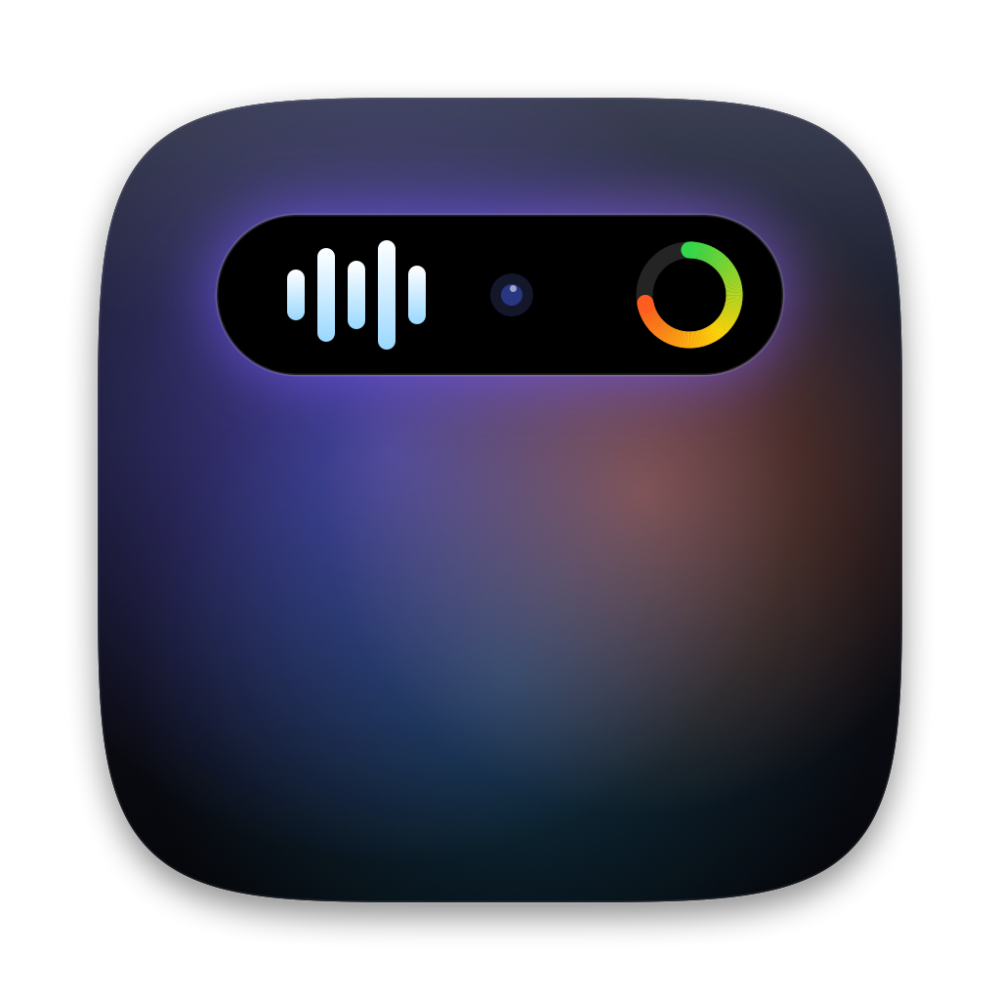

<p align="center"></p>

<h1 align="center">NotchIsland</h1>

Dynamic Island untuk Mac. App ini mengubah notch MacBook menjadi pulau hidup yang menampilkan aktivitas **Claude Code**, **Antigravity**, media yang sedang diputar, peringatan limit, dan command terminal yang selesai.

App otomatis mendeteksi device dan ukuran notch, jadi posisinya presisi. Di layar tanpa notch (monitor eksternal atau Mac lama), app membuat "pulau virtual" setinggi menu bar.

> NotchIsland tidak berafiliasi dengan Anthropic, Google, maupun Apple.

---

## Fitur

### Live activity (notch melebar sementara)

| Kejadian | Tampilan | Bunyi |
|---|---|---|
| Claude / Antigravity sedang bekerja | logo berputar/berdenyut + % limit + ring | – |
| Agent menunggu izin | logo oranye · apa yang diminta, mis. `Bash` · `npm install axios` ✋ | – |
| Prompt selesai | ✓ hijau "Selesai" (4 dtk) | Glass |
| Limit melewati 80% / 95% | nama jendela · "habis ±15.20" · % + ring | Ping / Sosumi |
| Limit reset | "Limit reset" ↻ hijau | Hero |
| Command terminal ≥30 dtk selesai | ✓ / ✗ · command · durasi (klik → buka terminal) | Tink / Basso |
| Media mulai diputar / berganti | thumbnail + equalizer (4 dtk) | – |
| Charger dicolok | ⚡ "Mengisi Daya" + baterai | – |

**Klik** sisi kiri/kanan notch saat live activity agent atau terminal tampil untuk langsung membuka app-nya (Claude Desktop / terminal tempat Claude berjalan, Antigravity, atau terminal command). Arahkan kursor ke notch untuk membuka island.

Saat tidak ada kejadian, notch kembali hitam polos seperti bawaan Mac.

### Island terbuka (arahkan kursor ke notch)

Tab widget ada di kiri notch. Jam dan baterai ada di kanan.

| Widget | Isi |
|---|---|
| **Claude** | Kartu *Claude Usage* (limit sesi/mingguan resmi + waktu reset + perkiraan habis), kartu sesi (prompt, tool aktif, progress task list, ukuran konteks) |
| **Antigravity** | Kuota per model (Gemini, Claude & GPT × 5 jam/mingguan), status agent |
| **Sedang Diputar** | Artwork/thumbnail, judul, artis/channel, progress, ⏮ ⏯ ⏭. Mendukung semua pemutar, termasuk YouTube di browser |
| **Jam & Kontrol** | Jam, tanggal, slider volume & brightness (nonaktif secara default) |
| **Folder** | Shortcut Home, Desktop, Dokumen, Unduhan, Aplikasi (nonaktif secara default) |

---

## Instalasi

Ada dua cara: **unduh DMG** (paling mudah, tanpa terminal) atau **build sendiri dari source**.

### A. Unduh DMG (disarankan)

1. Unduh **[NotchIsland.dmg](https://github.com/achmadtaufikhidayatullah/NotchIsland/releases/latest/download/NotchIsland.dmg)** dari halaman [Releases](https://github.com/achmadtaufikhidayatullah/NotchIsland/releases/latest).
2. Buka file DMG, lalu seret **NotchIsland** ke folder **Applications**.
3. Buka NotchIsland dari folder Applications. App ini belum dinotarisasi Apple, jadi pertama kali dibuka macOS akan menolaknya:
   - buka **Pengaturan Sistem › Privasi & Keamanan**, gulir ke bawah, lalu klik **Tetap Buka** (*Open Anyway*) di samping NotchIsland; **atau**
   - jalankan di Terminal: `xattr -dr com.apple.quarantine /Applications/NotchIsland.app`
4. Ikon kapsul muncul di menu bar. Lanjutkan ke [langkah 5](#5-jalankan) dan seterusnya untuk mengaktifkan login otomatis dan integrasi.

Mendukung Apple Silicon dan Intel. Di Mac tanpa notch, island muncul sebagai pulau virtual di menu bar.

### B. Build dari source — cara cepat (kalau sudah terbiasa dengan terminal)

```bash
xcode-select --install          # sekali saja, kalau belum
git clone https://github.com/achmadtaufikhidayatullah/NotchIsland.git ~/Development/Swift/NotchIsland
cd ~/Development/Swift/NotchIsland
./build.sh && open build/NotchIsland.app
./hooks/install-hooks.sh        # status Claude Code
./hooks/install-zsh-hook.sh     # notifikasi command terminal (opsional)
```

### C. Build dari source — langkah demi langkah (untuk pemula)

Total waktunya sekitar 10–20 menit, kebanyakan untuk mengunduh compiler di langkah 2. Cukup **salin & tempel** perintah di kotak abu-abu ke Terminal, lalu tekan **Enter**.

#### 0. Pastikan Mac-mu cocok

Klik logo  di pojok kiri atas › **Tentang Mac Ini**. Yang dibutuhkan:
- **Chip:** Apple M1 atau lebih baru, atau Intel (di Mac Intel tidak ada notch, jadi island muncul sebagai pulau virtual)
- **macOS:** 14 (Sonoma) atau lebih baru

#### 1. Buka Terminal

Tekan `⌘ Command` + `Spasi`, ketik **Terminal**, lalu tekan Enter. Semua perintah di bawah dijalankan di jendela ini.

#### 2. Pasang Xcode Command Line Tools (compiler dari Apple, gratis)

```bash
xcode-select --install
```

Akan muncul jendela dialog. Klik **Install**, setujui lisensinya, lalu tunggu sampai selesai (±5–15 menit). Kalau muncul pesan *"already installed"*, berarti sudah terpasang dan kamu bisa langsung ke langkah berikutnya.

#### 3. Unduh kode NotchIsland

```bash
mkdir -p ~/Development/Swift
git clone https://github.com/achmadtaufikhidayatullah/NotchIsland.git ~/Development/Swift/NotchIsland
cd ~/Development/Swift/NotchIsland
```

Kamu boleh memakai folder lain, asalkan perintah `cd` mengarah ke folder tersebut.

#### 4. Build aplikasinya

```bash
./build.sh
```

Proses ini memakan waktu ±1 menit dan selesai dengan pesan **✓ Selesai**. Semua yang dibutuhkan sudah ada di repo (termasuk decoder zstd di `ThirdParty/`), jadi tidak perlu Homebrew. Kalau ada yang kurang, skrip memberi tahu perintah yang perlu dijalankan. Kalau muncul `permission denied`, jalankan `chmod +x build.sh release.sh hooks/*.sh` lalu ulangi.

#### 5. Jalankan

```bash
open build/NotchIsland.app
```

- Tidak ada jendela yang terbuka. Yang muncul adalah **ikon kapsul** di menu bar kanan atas, dan itulah pusat pengaturannya.
- **Arahkan kursor ke notch** untuk membuka island.
- Supaya otomatis jalan setiap Mac dinyalakan: ikon kapsul › **Buka saat login**.

#### 6. Hubungkan Claude Code (opsional, untuk monitoring Claude)

Klik ikon kapsul › **Integrasi** › **Claude Code (status sesi)** › **Hubungkan**.

Lalu **mulai prompt baru** di Claude Code (terminal atau aplikasi Claude Desktop). Island akan menampilkan status kerjanya. Untuk persen limit resmi, cukup buka **aplikasi Claude Desktop** sekali.

#### 7. Notifikasi command terminal (opsional)

Klik ikon kapsul › **Integrasi** › **Terminal zsh (command selesai)** › **Aktifkan**.

Tutup lalu buka lagi Terminal. Uji dengan `sleep 31`, lalu pindah ke app lain: notch akan menampilkan ✓ saat command selesai.

#### 8. Izin yang mungkin diminta macOS

| Dialog | Kapan | Pilih |
|---|---|---|
| *"NotchIsland ingin mengontrol Music/Spotify"* | Saat Music/Spotify terbuka | **Izinkan**, supaya widget musik bisa membaca lagu |
| *"Item login ditambahkan"* | Saat mengaktifkan Buka saat login | Notifikasi biasa, tidak perlu tindakan |

### Memperbarui ke versi terbaru

```bash
cd ~/Development/Swift/NotchIsland
git pull
./build.sh
pkill -x NotchIsland; open build/NotchIsland.app
```

> Build bersifat ad-hoc signed (tanpa sertifikat Apple Developer). Karena di-build sendiri dari source, macOS tidak memblokirnya. Setelah build ulang, macOS bisa meminta izin Otomatisasi (Music/Spotify) lagi.

---

## Detail hook (referensi)

Hook dibutuhkan untuk status Claude Code dan notifikasi terminal. Cara termudah: menu ikon kapsul › **Integrasi** (klik lagi untuk melepas). Skrip di `hooks/` melakukan hal yang sama dari terminal. Semua perubahan hanya menyentuh entri milik NotchIsland, dan file aslinya dibackup lebih dulu.

### 1. Hook Claude Code

Menulis status sesi (bekerja / menunggu / selesai, tool aktif, task list) yang dibaca island.

```bash
./hooks/install-hooks.sh              # pasang
./hooks/install-hooks.sh --uninstall  # lepas
```

- Mengubah `~/.claude/settings.json` (backup: `settings.json.bak-notchisland`)
- Event: `UserPromptSubmit`, `PreToolUse`, `PostToolUse`, `Notification`, `Stop`, `SessionEnd`
- Hook dijalankan oleh app NotchIsland sendiri (`NotchIsland --claude-hook`, ±10 ms per tool), tanpa Python atau dependensi lain
- Kalau app dipindah (misalnya ke folder Aplikasi) atau masih memakai hook versi lama, path hook otomatis diperbarui saat NotchIsland dibuka
- Berlaku untuk Claude Code di terminal maupun di aplikasi Claude Desktop (tab Code)

### 2. Hook terminal (zsh)

Memberi tahu island saat command yang berjalan ≥30 detik selesai.

```bash
./hooks/install-zsh-hook.sh              # pasang
./hooks/install-zsh-hook.sh --uninstall  # lepas
```

- Menambah satu baris `source …` di `~/.zshrc` (backup: `.zshrc.bak-notchisland`)
- Aktif di tab/jendela terminal **baru**, atau setelah `source ~/.zshrc`
- Ubah ambang: `export NOTCH_MIN_SECONDS=60` di `~/.zshrc`
- Diabaikan: Ctrl-C, dan program interaktif (`vim`, `ssh`, `top`, `tail`, `claude`, REPL `node`/`python`, …)

Antigravity dan widget musik **tidak** memerlukan hook.

---

## Menu (ikon kapsul di menu bar)

| Item | Fungsi |
|---|---|
| **Widget** (centang) | Aktifkan/nonaktifkan Claude, Antigravity, Sedang Diputar, Jam & Kontrol, Folder |
| Bunyi notifikasi agent & limit | Bunyi untuk agent selesai, peringatan limit, dan terminal |
| Selalu tampilkan usage Claude | Ring % Claude tetap terlihat walau Claude diam (default: mati) |
| Integrasi › | Pasang/lepas hook **Claude Code** dan **Terminal zsh** (dengan konfirmasi & backup) |
| Notifikasi command terminal | Nyalakan/matikan notifikasi terminal (hook tetap terpasang) |
| Buka saat login | Jalankan NotchIsland otomatis setelah login / restart |
| Live activity musik › | *Sekilas saat mulai / berganti* (default), *Selama diputar*, *Mati* |
| Tes notifikasi charger / limit / terminal | Lihat contoh tampilan tanpa menunggu kejadian aslinya |
| Deteksi ulang layar | Hitung ulang posisi notch (mis. setelah ganti monitor) |

---

## Data yang dibaca

NotchIsland **tidak mengirim data ke server mana pun** dan tidak menyimpan prompt atau isi percakapan.

| Sumber | Apa yang dibaca | Catatan |
|---|---|---|
| `~/Library/Application Support/NotchIsland/claude/*.json` | Status sesi dari hook Claude | Ditulis oleh hook sendiri |
| `~/.claude/projects/**/*.jsonl` | Hanya angka `usage` token per pesan | Untuk estimasi & ukuran konteks |
| Cache HTTP Claude Desktop | Response `/api/organizations/<id>/usage` (persen limit resmi) | Dari entry lain hanya URL-nya yang dibaca; tanpa token/keychain |
| `~/.gemini/antigravity*/brain/*/…/transcript.jsonl` | Tipe baris terakhir (status agent) | Hanya bagian akhir file (64 KB) |
| Language server Antigravity (`127.0.0.1`) | Ringkasan kuota | Token CSRF lokal dibaca dari daftar proses, hanya dikirim ke 127.0.0.1, tidak disimpan |
| Now Playing sistem (via `/usr/bin/perl`) | Judul, artis, artwork, progress media | Lihat catatan di bawah |
| Music / Spotify (AppleScript) | Lagu yang diputar | Cadangan bila Now Playing sistem kosong; perlu izin Otomatisasi |
| `~/Library/Application Support/NotchIsland/terminal/*.json` | Command, exit code, durasi, folder | Ditulis hook zsh, langsung dihapus setelah dibaca |

---

## Catatan teknis & risiko

- **Limit resmi Claude** dibaca dari cache internal Claude Desktop, yang formatnya tidak didokumentasikan. Kalau formatnya berubah, island otomatis kembali ke estimasi token lokal.
- **Kuota Antigravity** hanya bisa diambil saat Antigravity terbuka. Angka terakhir tetap ditampilkan beserta umurnya.
- **Now Playing sistem**: sejak macOS 15.4, app pihak ketiga tidak bisa membaca Now Playing. NotchIsland memuat `NowPlayingBridge.dylib` ke dalam `/usr/bin/perl` (binary Apple yang masih diizinkan). Ini celah, bukan API resmi. Kalau Apple menutupnya, widget kembali ke mode Music/Spotify.
- **Slider brightness** memakai framework privat `DisplayServices`. Kalau tidak tersedia, slider disembunyikan.

---

## Troubleshooting

| Masalah | Solusi |
|---|---|
| Status Claude tidak muncul | Pastikan menu › Integrasi › Claude Code tercentang (atau `grep -- --claude-hook ~/.claude/settings.json`). Mulai prompt baru setelah memasang. |
| Persen limit Claude kosong | Buka Claude Desktop sekali (cache-nya perlu ada). |
| Kuota Antigravity "tertutup" | Buka Antigravity IDE. |
| Notif terminal tidak muncul | Buka tab terminal baru, lalu cek `whence -w _notch_precmd` (harus `function`). Uji dengan `sleep 31`. |
| Musik/YouTube tidak terbaca | Cek apakah media muncul di Control Center › Now Playing. Untuk Music/Spotify, izinkan di Pengaturan Sistem › Privasi & Keamanan › Otomatisasi. |
| Posisi notch meleset | Menu › Deteksi ulang layar. |
| Cek data dari terminal | `build/NotchIsland.app/Contents/MacOS/NotchIsland --print-claude` |
| Uji logika peringatan limit | `build/NotchIsland.app/Contents/MacOS/NotchIsland --test-limits` |

---

## Membuat rilis (untuk maintainer)

```bash
./release.sh 1.0.0
```

- Build **universal** (Apple Silicon + Intel), lalu membuat `dist/NotchIsland-1.0.0.dmg` dan salinan bernama tetap `dist/NotchIsland.dmg`.
- Buat rilis baru di GitHub dengan tag `v1.0.0`, lalu unggah **`dist/NotchIsland.dmg`**. Link download di README dan landing page selalu mengarah ke rilis terbaru lewat nama file ini.
- Untuk pengembangan sehari-hari, `./build.sh` cukup membangun untuk arsitektur Mac-mu saja (lebih cepat). Build universal: `ARCHS="arm64 x86_64" ./build.sh`.
- App ditandatangani ad-hoc dan belum dinotarisasi. Supaya bisa dibuka dengan dobel klik tanpa peringatan Gatekeeper, diperlukan sertifikat Developer ID dari Apple Developer Program.

---

## Mencopot sepenuhnya

```bash
./hooks/install-hooks.sh --uninstall
./hooks/install-zsh-hook.sh --uninstall
pkill -x NotchIsland
rm -rf ~/Library/Application\ Support/NotchIsland
defaults delete local.notchisland
```

---

## Struktur proyek

```
NotchIsland/
├── Sources/
│   ├── main.swift          # deteksi notch, model, tampilan, menu
│   ├── Widgets.swift       # daftar widget & tab
│   ├── Claude.swift        # sesi Claude dari hook + estimasi token
│   ├── ClaudeUsage.swift   # limit resmi dari cache Claude Desktop + kartu usage
│   ├── Antigravity.swift   # aktivitas & kuota Antigravity
│   ├── LimitWatch.swift    # peringatan 80/95%, reset, perkiraan habis
│   ├── TerminalWatch.swift # notifikasi command terminal
│   └── Media.swift         # Now Playing sistem + Music/Spotify
├── NowPlayingBridge/       # dylib + loader Perl untuk Now Playing sistem
├── hooks/                  # hook Claude, hook zsh, skrip pasang/lepas
├── assets/                 # ikon app (make-icon.swift → AppIcon.icns)
├── ThirdParty/zstd/        # decoder zstd v1.5.7 (source resmi, BSD)
├── zstd-bridge.h           # header zstd untuk Swift
├── build.sh                # build app (arsitektur Mac ini / universal)
└── release.sh              # build universal + DMG
```

---

## Lisensi

[MIT](LICENSE)

---

## Kredit

- Pendekatan membaca limit dari cache Claude Desktop dan kuota dari language server Antigravity terinspirasi dari [Codenotch](https://github.com/IGedeMiarta/codenotch) (MIT).
- Decoder [zstd](https://github.com/facebook/zstd) v1.5.7 oleh Meta (BSD), disertakan di `ThirdParty/zstd`.
- Jembatan Now Playing ditulis ulang mengikuti pola [mediaremote-adapter](https://github.com/ungive/mediaremote-adapter) (BSD-3-Clause).
